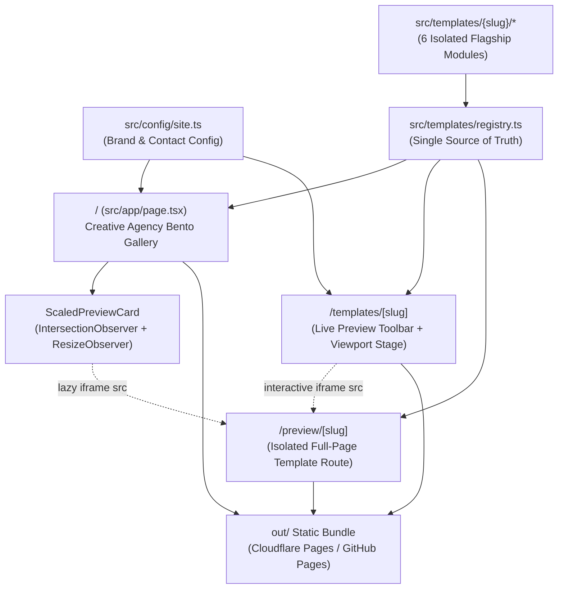

# Application Architecture & Technical Design (`architecture.md`)

- **Phase**: `INCEPTION`
- **Stage**: `Stage 1.4 — Application Design`

---

## 1. High-Level System Architecture

---

## 2. Component Boundaries & Data Contracts

### 2.1 Module Map
- **`src/config/site.ts`**: Nguồn dữ liệu duy nhất cho thương hiệu (**Awesome UI Studio**), navigation, metadata SEO và kênh liên hệ (Hotline/Zalo, Email, Facebook, Địa chỉ, Giờ làm việc).
- **`src/templates/types.ts` & `src/templates/registry.ts`**: Khai báo kiểu dữ liệu (`TemplateCategory`, `TemplateMetadata`, `TemplateRegistryEntry`) và hàm truy vấn (`getTemplateBySlug`, `getTemplatesByCategory`, `getAdjacentTemplates`).
- **`src/templates/<slug>/`**: Mỗi mẫu giao diện là một module React độc lập gồm `index.tsx` và dữ liệu tiếng Việt cục bộ (`data.ts`), tự quản lý state tương tác và bảng màu/phong cách riêng.
- **`src/components/gallery/`**: Các thành phần của trang chủ Creative Agency (`StudioHeader`, `AgencyHero`, `TemplateFilterBar`, `BentoGalleryGrid`, `ScaledPreviewFrame`, `ProcessSection`, `StudioFooter`).
- **`src/components/preview/`**: Các thành phần của trình xem mẫu (`PreviewShell`, `PreviewToolbar`, `ViewportCanvas`).
- **`src/app/templates/[slug]/page.tsx`**: Trang xem mẫu có `generateStaticParams()` và `generateMetadata()` (SEO/OG riêng cho từng mẫu).
- **`src/app/preview/[slug]/page.tsx`**: Route cô lập hoàn toàn không gắn Header/Footer của Gallery, chỉ render component mẫu ở kích thước 100% viewport để nhúng vào `<iframe>`.

### 2.2 Core Data Contracts
- **Static Route Generation**:
  - `src/app/templates/[slug]/page.tsx` và `src/app/preview/[slug]/page.tsx` đều export `generateStaticParams()` đọc từ `TEMPLATE_REGISTRY`.
  - Hỗ trợ helper `withBasePath(path)` dựa trên `process.env.NEXT_PUBLIC_BASE_PATH || ""` cho `iframe src` (vì thẻ `<iframe src>` thuần HTML không tự động cộng `basePath` như `next/link`).
- **Scaled Live Thumbnail Mechanism (`ScaledPreviewFrame`)**:
  - Giả lập viewport desktop gốc `1440 × 900` bên trong `<iframe>` với `pointer-events: none`, `tabIndex={-1}`, `aria-hidden="true"`.
  - Dùng `ResizeObserver` tính tỷ lệ `scale = containerWidth / 1440` để co giãn sắc nét theo đúng chiều rộng thẻ Bento (wide / tall / standard).
  - Dùng `IntersectionObserver` (`rootMargin: "250px"`) để chỉ mount `<iframe>` khi thẻ gần khung nhìn, hiển thị shimmer skeleton cho tới sự kiện `onLoad`.
- **Viewport Switcher (`PreviewShell`)**:
  - `desktop`: `w-full h-full` (100% chiều rộng khung xem)
  - `tablet`: `w-[768px]` căn giữa trong khung stage có viền thiết bị tinh tế
  - `mobile`: `w-[390px]` căn giữa mô phỏng khung điện thoại hiện đại
  - `fullscreen`: Ẩn thanh toolbar (chỉ giữ nút nổi nhỏ góc dưới phải để thoát) hoặc nút mở trực tiếp `/preview/[slug]` ở tab mới.

### 2.3 Isolation, Security & Failure Modes
- **CSS & Scroll Isolation**: Nhờ render qua `/preview/[slug]` trong `<iframe>`, các hiệu ứng `sticky`/`fixed`, `min-h-screen`, bảng màu dark/light và media queries của từng mẫu không bao giờ xung đột với trang Gallery.
- **Unsplash Image Fallback**: Tạo component dùng chung `SafeImage` (`src/components/ui/SafeImage.tsx`) bọc thẻ `` với `loading="lazy"`, hiệu ứng fade-in khi tải xong và gradient fallback có biểu tượng tinh tế nếu URL ngoài gặp sự cố mạng.
- **Static Export Safety**: Tuyệt đối không dùng `cookies()`, `headers()`, API routes hoặc `next/image` optimizer mặc định; toàn bộ build xuất tĩnh sang `out/`.
